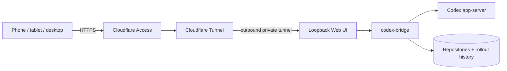

# Codex App Server WebUI for Homelab and NAS

Access OpenAI Codex app-server from a responsive Web UI or CLI running on your homelab, NAS, Mac
mini, or Linux host. Continue the same tasks from any device while Codex stays beside your
repositories.

[](docs/assets/codex-bridge-mobile.jpg)

[This fork](https://github.com/hhaa12321/codex-bridge) ·
[Upstream](https://github.com/hitsmaxft/codex-bridge) ·
[Install](docs/install.md) ·
[`codexctl` reference](docs/codexctl.md) ·
[Design](DESIGN.md) ·
[Debugging](DEBUGGING.md) ·
[MIT License](LICENSE)

> **Community fork:** This repository is maintained by
> [@hhaa12321](https://github.com/hhaa12321) and is based on
> [`hitsmaxft/codex-bridge`](https://github.com/hitsmaxft/codex-bridge). It is an independent fork,
> not an official upstream release. All source in this repository, including changes made here, is
> available under the [MIT License](LICENSE).

`codex-bridge` connects directly to app-server and its rollout store. It keeps task history, live
tools and diffs, Queue/Steer/Stop controls, models, and task metadata behind one typed local
protocol—without using the ChatGPT app as a remote-control relay. Keep the Web UI on loopback, or
publish it through Cloudflare Access, a VPN, or an authenticated reverse proxy. Model requests
use the API-key provider configured for Codex; no ChatGPT browser login is required. The tested
Codex CLI/app-server version is pinned to `0.164.0`.

## What it provides

- A shared task list and persistent live connection for the Web UI and `codexctl`.
- Structured messages, tool calls, diffs, status, models, and paginated history.
- Terminal-style command output with live progress, exit codes, and parsed JSON when available.
- On-demand summaries for a group of tool calls, shown in a closable dialog.
- Composer slash commands and skill selection, with inline computer-use screenshots.
- Paste images into the composer or attach files of any format (up to 32 MiB per file).
- Remote Queue, Steer, withdrawal, interruption, pinning, custom sections, renaming, and archiving.
- Edit and rerun the latest interrupted prompt when that turn has no Steer input.
- Fork a completed turn into a new session in the current directory or a new Git worktree.
- Create a session directly from a project row, choosing the current directory or a new worktree.
- Editable voice transcription through app-server, with an optional managed local whisper.cpp
  fallback for private Mac, Linux, homelab, and NAS deployments.
- Bounded caches and authenticated file preview and downloads for long-running hosts.
- Installable phone-first PWA with a static offline fallback; sessions, credentials, API responses,
  and app content are never cached.

## Release highlights

### v0.3.14 · 2026-10-22

- **Conversation state:** compaction is visible while it runs, and Goal stays as a single line beside the session title until opened.
- **Tools and usage:** running tool groups show elapsed time; session token totals include each model's reasoning effort.
- **Reliability:** stale queued messages can be withdrawn after a turn ends, and tool images remain available in session history.

See the [latest release notes](docs/releases/v0.3.14.md) or the
[complete release history](docs/releases/).

## Web UI

[Try the upstream interactive demo](https://gh.bhee.online/codex-bridge/demo/). It runs the
production Vite frontend against a Rust/WASM simulator entirely in the browser. Submit different
prompts to see template-driven progress and structured tools, steer or queue another message while
it runs, withdraw queued work, cancel the run, or try simulated voice-to-text. Demo submissions and
images never contact Codex or leave the page.

The private UI is responsive across mobile and desktop. It includes project and task navigation,
rendered tool calls and diffs, task pinning, renaming, and archiving, model selection, Git change summaries,
English and Chinese text, queue/steer message handoff, and opt-in browser notifications when a run
finishes while the page is in the background. Large pasted text appears as a file attachment in the
conversation. Tool images can be viewed at their call and browsed in the message gallery.
Settings shows token usage for the past 7 and 30 days, plus daily and 20-minute charts of the weekly limit remaining. The charts begin collecting samples after Bridge starts recording them.
Session information shows total token usage broken down by model.
Notifications require site permission and an open Web UI
page; clicking one focuses the page and opens that session. Local file links can download regular
files smaller than 33 MiB; the server resolves each link against that task's workspace or an
explicitly configured visible directory and rejects paths or symlinks outside those roots.
Authenticated clients receive a random download ticket that
expires after five minutes and tolerates browser or proxy retries. Tickets live only in bridge
process memory and become invalid after a restart, so downloads do not expose a long-lived
anonymous file endpoint or depend on Basic Auth being forwarded by a navigation.

The Web UI is deliberately not terminal-first. Projects and recent sessions lead into a chat
workspace; execution, approval, clarification, reconnect, and writer-conflict states stay close to
the conversation. Queue remains available when another app-server owns the writer, while direct
writes and explicit lock acquisition stay disabled until ownership is available.

## How it connects

There are two supported app-server sources. **Use standalone mode by default**, including on
macOS. It keeps Bridge on an independently installed Codex CLI/app-server and avoids coupling the
service to a changing App bundle and private bundled runtime. On Linux the default installer also
starts `ws-unix-bridge`; Desktop and Web then use that same standalone app-server.

### Standalone Codex (recommended)

```text
Codex Desktop ── ws-unix-bridge ─┐
                                  ├── one standalone app-server ── Unix WebSocket ── codex-bridge
Web UI / codexctl ────────────────┘
                                                        │
                                                   rollout store
```

Bridge supervises the standalone app-server on its Unix socket. The Linux installer creates a
**Codex Bridge Desktop** launcher that points the Desktop client at `ws-unix-bridge`; fully quit the
ordinary Desktop process before switching. With that launcher, Desktop and Web share one project and
session list, receive the same live events, and can both send messages, steer, interrupt, or approve
work. Do not launch a second private stdio app-server for the same `CODEX_HOME`: that creates a real
cross-process writer conflict and the Web UI correctly becomes read-only.

### Codex Desktop interposition on macOS (advanced)

```text
Codex Desktop ── TCP WebSocket ── ws-unix-bridge ── Unix WebSocket ── app-server
                                                         ▲                 ▲
                                                         │                 │
                                             codex-bridge daemon ── rollout store
                                                    ▲
                                             Web UI / codexctl
```

The app-server executable comes from `ChatGPT.app`. In explicit desktop mode,
`codex-bridge` supervises both that process and the loopback adapter, then publishes
`CODEX_APP_SERVER_WS_URL` through the user's launchd environment. launchd only has to keep the one
bridge daemon alive. This transport interposition is local and does not patch or re-sign the app
bundle. Bridge owns the managed app-server lifecycle so session maintenance can stop the writer,
repair a rollout atomically, and restart it without a competing process. The managed Desktop app-server also
starts with a disabled `mcp_servers.codex_app` base entry; Desktop can then send its incremental
`enabled_tools` configuration and resume an existing thread directly, without a Web UI preload.

See [Installation and service setup](docs/install.md) for global Cargo installation, launchd and
systemd examples, optional Web UI configuration, validation, and rollback.

For remote browser access, keep the service on loopback and place it behind Cloudflare Zero Trust:



Use a Cloudflare Named Tunnel, not a Quick Tunnel. The complete Access policy, dual-auth,
WebSocket, validation, and rollback procedure is in
[`docs/cloudflare-access.zh-CN.md`](docs/cloudflare-access.zh-CN.md).

The user-level installers build the embedded frontend, install the required Cargo binaries, write
`~/.config/codex-bridge/config.toml`, and start the appropriate user services without `sudo`:

```sh
./scripts/install-macos.sh --web-ui  # standalone Codex + launchd (recommended)
./scripts/install-macos.sh --desktop --web-ui  # optional App bundle interposition
./scripts/install-linux.sh --web-ui  # standalone app-server + systemd --user
```

The generated launchd/systemd bridge service contains only `codex-bridge --config ...`. Runtime
mode, managed app-server/adapter lifecycle, sockets, Web UI, authentication, and cache choices live
in the TOML file rather than being duplicated across startup scripts. Existing argument-only and
externally managed deployments remain supported.

Rerun the same installer to update. It builds the frontend, uses `cargo install --locked --force`
for the Bridge binaries, and restarts the existing user service. On macOS it retains an existing
Bridge LaunchAgent label; an enabled Whisper fallback automatically includes the `whisper` feature.
See [the update instructions](docs/install.md#updating) for details and `--no-start`.

## Quick check

After installing and starting the services:

```sh
codexctl status
codexctl ls --limit 10
codexctl show --last 20
```

The optional Web UI listens on `127.0.0.1:18791` by default and normally requires a private
password file. The sign-in page supports password-manager autofill and creates a seven-day
HttpOnly session cookie whose private token survives ordinary bridge restarts. A same-host
HTTPS Web UI also supports passkey sign-in; add and remove passkeys in Settings using the current
password. Password sign-in remains available. An authenticated proxy may use
`--web-ui-no-auth` only for a trusted loopback deployment; configuring `public_origins` together
with `no_auth = true` is rejected so a public proxy cannot become the only authentication layer.

For managed startup, configure `OPENAI_API_KEY`, `api_key_file`, or an API-key provider in the
active Codex config. Settings → Connection & diagnostics shows only the source category and whether
the Base URL is configured, plus Bridge, CLI, app-server, schema, active-turn, public-origin, and
writer state. It never returns the credential value.

## Components

- `crates/codex-bridge`: local daemon, shared protocol, rollout reader, app-server client, and
  embedded Web UI.
- `crates/codexctl`: terminal client for the bridge Unix socket.
- `crates/codex-gui-bridge`: `ws-unix-bridge` Desktop transport plus retained experimental broker
  tooling.
- `web-ui`: Vite source and deterministic production assets embedded in `codex-bridge` at compile
  time.
- `crates/codex-bridge-demo`: bounded Rust/WASM simulator used by GitHub Pages.
- `scripts/install-macos.sh` and `scripts/install-linux.sh`: user-owned service installers.
- `config.example.toml`: documented bridge runtime configuration template.

The daemon control socket defaults to `~/.codex-bridge/control.sock`; override it with `--socket`
or `CODEX_BRIDGE_SOCKET`. It creates its default directory as `0700` and socket as `0600`.

## Development

```sh
npm --prefix web-ui ci
CARGO_INCREMENTAL=0 cargo build --release --target wasm32-unknown-unknown \
  -p codex-bridge-demo
npm --prefix web-ui run test:demo-wasm
npm --prefix web-ui run build
CARGO_INCREMENTAL=0 cargo test --workspace --no-fail-fast
```

The frontend production bundle is checked in under `web-ui/dist` and embedded with `include_str!`.
Rebuild it before compiling Rust after a UI change. For frontend-only work, run
`npm --prefix web-ui run dev`; Vite proxies `/api` to `127.0.0.1:18791`.

The Web UI and CLI share typed bridge requests. Rollout files provide durable reads; live
operations use the selected app-server endpoint. Commands never choose a write target by file
modification time. See [`docs/codexctl.md`](docs/codexctl.md) for command semantics and current
implementation limits.

## Contributing

Issues and pull requests are welcome in this fork. Keep changes focused, preserve unrelated work,
and include the validation you ran. Before sending a change, run the relevant frontend tests,
production build, Rust tests, formatting checks, and dependency checks described in this README
and `AGENTS.md`.

## Security

Do not put API keys, password files, session cookies, private repository paths, or production logs
in issues, pull requests, screenshots, or test fixtures. Keep the Web UI on loopback or behind an
authenticated private-access layer. Report vulnerabilities through this repository's private
vulnerability reporting or contact the fork maintainer through GitHub instead of opening a public
issue containing exploit details or credentials.

## License

This fork is distributed under the [MIT License](LICENSE). The original copyright notice and the
permission notice are retained, and modifications published here are made available under the same
license.
